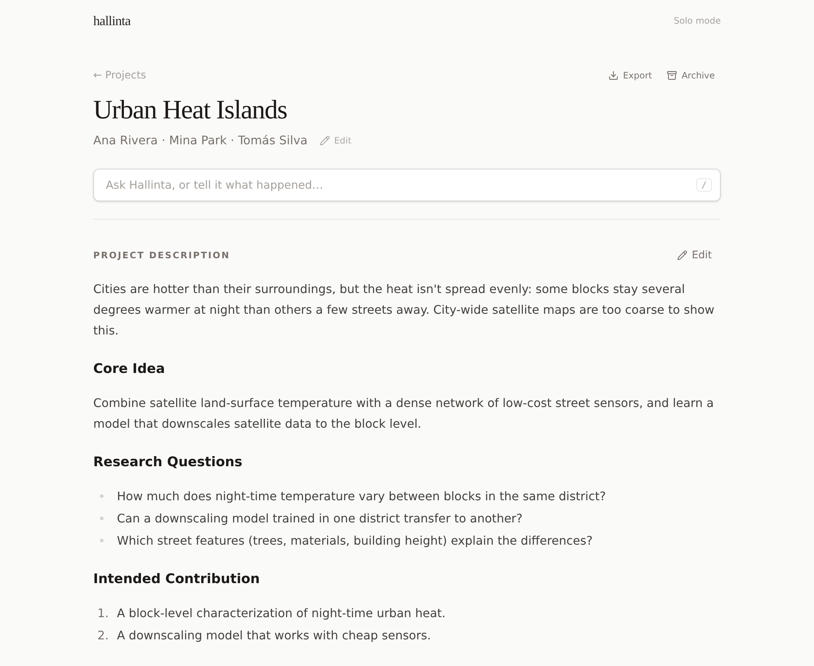
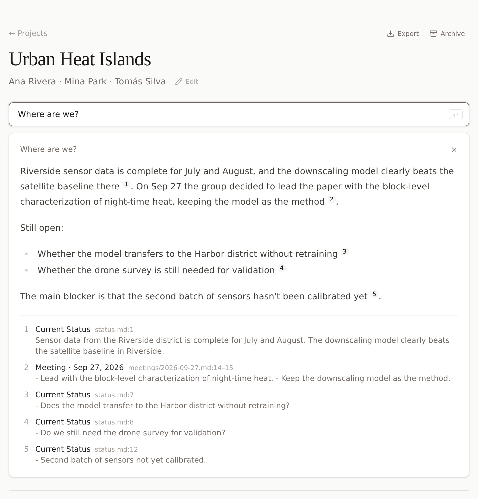
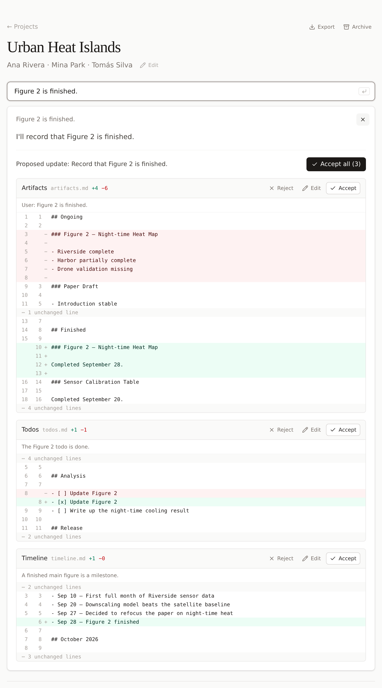
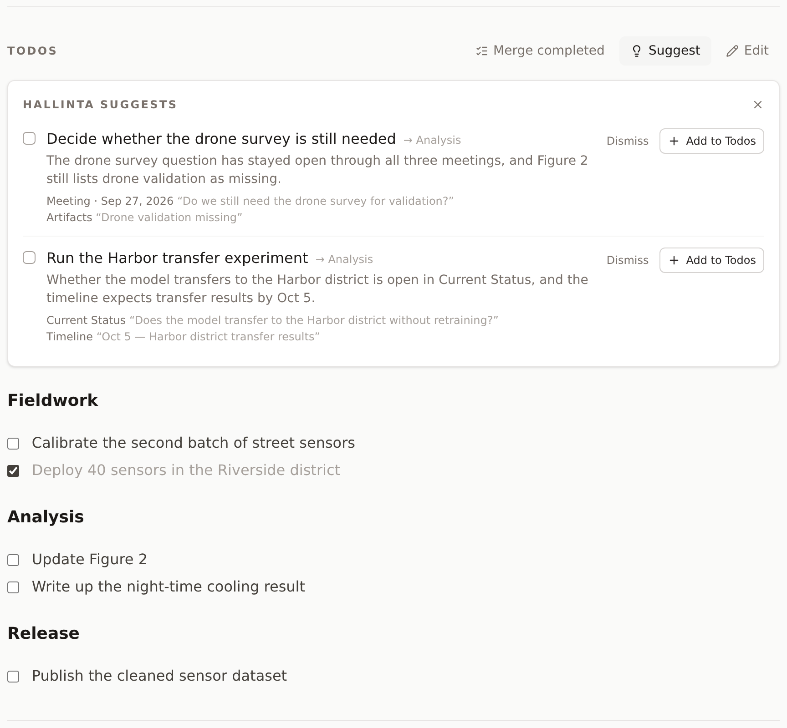
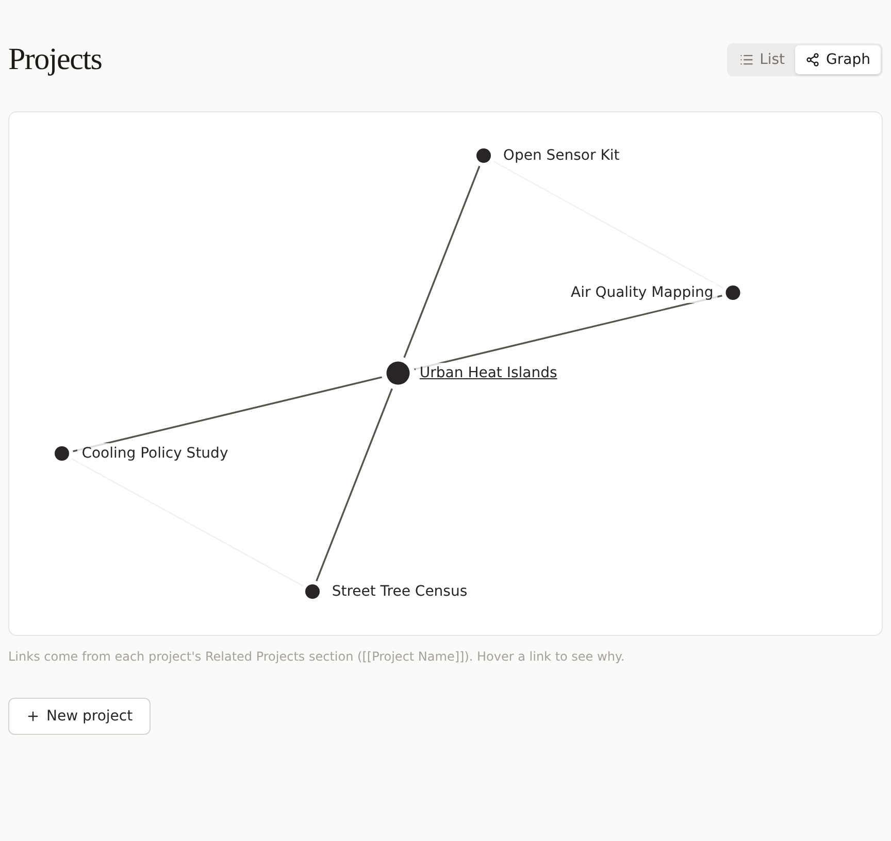
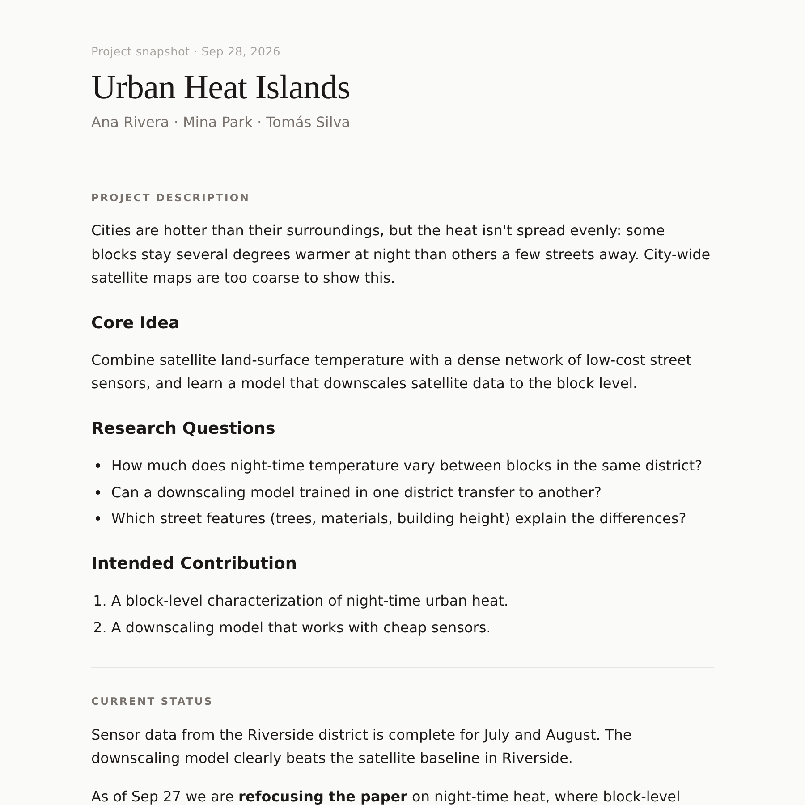

# Hallinta

**A research project tool for academic labs, built on living Markdown documents.**

Research projects don't move through tickets. Questions change, experiments fail, framing shifts, and new work comes out of every meeting. Hallinta keeps a lab's shared picture of each project — what it is, where it stands, what's being done and why — as a handful of plain Markdown files, shown as a calm, readable page. Hallinta, the AI collaborator, reads those files, answers questions with citations, and proposes edits that you review before anything changes.



## Features

- **One page per project**: description, current status, papers, resources, related projects, artifacts, todos, timeline, and meeting notes. Every section is a Markdown file you can edit in place.
- **Ask Hallinta**: ask "Where are we?" or "What changed in the last two meetings?" and get a short answer with numbered citations to the exact lines it relied on.

  

- **Tell Hallinta what happened**: "Figure 2 is finished" or "Update the project based on today's meeting". Hallinta proposes targeted edits and shows each file as a diff to accept, edit, or reject. Nothing is written without your approval, and guards warn when a proposal would drop an open todo or question.

  

- **Grounded todo suggestions**: Hallinta suggests next steps only when it can quote the lines that justify them. **Merge completed** folds ticked-off todos into the project's status.

  

- **Project graph**: see how the lab's projects connect, from the `[[Project Name]]` links in each project's Related Projects section. Archive finished projects to hide them.

  

- **HTML export**: share a project snapshot, or individual meeting notes, as self-contained files. Useful for sending a weekly update to students or collaborators.

  

- **Solo or team**: use it alone with no login, or turn on accounts so students and collaborators sign in and see only the projects shared with them (see [Solo and team modes](#solo-and-team-modes)).

## Quick start

Requires [Node.js](https://nodejs.org/) 22 or newer.

```bash
git clone <this repository> hallinta
cd hallinta
npm install
cp -r examples data          # optional: start with a fictional example lab
npm run dev                  # http://localhost:3000
```

To enable Hallinta's AI features, copy `.env.example` to `.env.local` and set `ANTHROPIC_API_KEY` ([get a key](https://platform.claude.com/settings/keys)). Everything else works without it.

For everyday use, run the production build instead: `npm run build && npm start`.

## Your data

Each project is a folder of Markdown files:

```text
data/
├── heat-islands/
│   ├── project.json          name, members, sharing
│   ├── description.md
│   ├── status.md
│   ├── papers.md
│   ├── resources.md
│   ├── related-projects.md
│   ├── artifacts.md
│   ├── todos.md
│   ├── timeline.md
│   └── meetings/
│       └── 2026-09-27.md
└── archive/                  archived projects
```

Hallinta reads `./data` by default, or the folder set in `HALLINTA_DATA_DIR`. The files are yours: edit them in any editor, sync them, or keep them in their own git repository for full history. `data/` is ignored by this repository so research content never ends up in app commits.

## AI models and cost

Hallinta uses Anthropic's Claude. By default it uses **Claude Haiku 4.5**, the cheapest model; a question about a typical project costs well under a cent.

For drafting edits (proposed updates and merging completed todos) we recommend a stronger model, which makes noticeably more faithful edits:

```bash
# .env.local
HALLINTA_UPDATE_MODEL=claude-sonnet-5
```

Project content is sent to the Anthropic API only when you use an AI feature. Account data never is.

## Solo and team modes

- **Solo** (default): no accounts and no login. Hallinta only serves the computer it runs on.
- **Team**: open **Solo mode → Set up accounts** (top right) on the computer running Hallinta to create the first **root** account (for PIs). After that, everyone signs in:
  - **root** manages people and can do everything;
  - **admin** creates projects, sees and edits all of them, and decides who has access;
  - **regular** users (students, collaborators) see only projects shared with them, with **view** or **edit** access. Only people with edit access can use the AI features, since they run on your API key.

  Projects are shared from their header: the members are the people with access. People sign in with a password root sets, or with Google (invite-only; see [docs/google-sign-in.md](docs/google-sign-in.md)).

A solo setup with weekly HTML exports is enough for many labs. To let others reach a team-mode Hallinta, run it on a machine they can reach, behind HTTPS (for example a reverse proxy such as Caddy), and opt in to network access:

```bash
npm run build && npm start -- -H 0.0.0.0
```

## Development

```bash
npm test             # unit tests (Node's test runner)
npm run typecheck
npm run build
```

- `src/lib/store/`: the `ProjectStore` interface and `LocalProjectStore`, the only code that touches project files.
- `src/lib/auth/`: roles and permissions (pure, unit-tested) and the server-side guard every page, action, and route uses; `tests/guard-coverage.test.ts` fails if one doesn't.
- `src/lib/ai/`: the `AiProvider` interface and the Anthropic implementation.
- `src/app/`: pages, server actions, and API routes (Next.js App Router).
- `examples/`: the fictional example lab, also used as test fixtures.
- `CLAUDE.md`: the product spec and design decisions.

Contributions are welcome: please keep changes small, add tests for new logic, and run `npm test` before opening a pull request.

## License

[MIT](LICENSE) © 2026 Yi-Chi Liao
